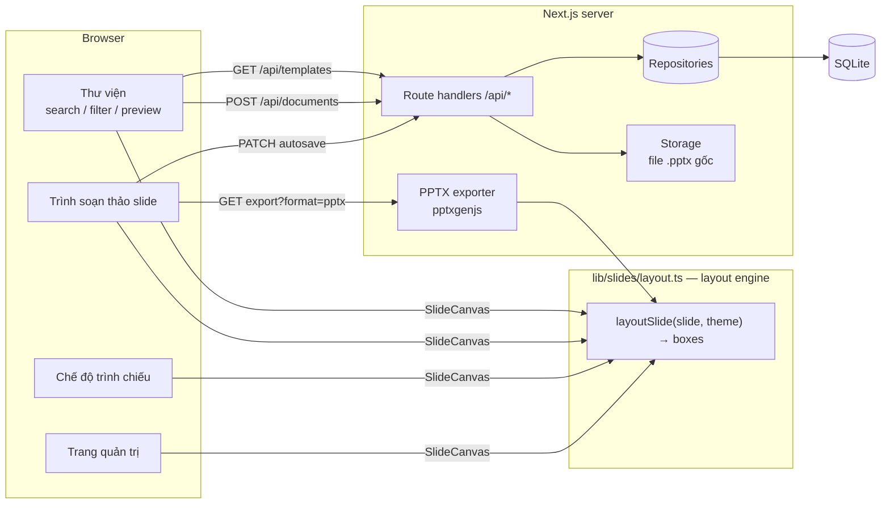

# Presentation Template Library — Sản phẩm 2: Thư viện mẫu trình chiếu

Ứng dụng web cho phép **tìm kiếm, xem trước từng slide, chọn một bộ template trình chiếu và tạo bản trình chiếu mới**,
chỉnh sửa ngay trên trình duyệt bằng **trình soạn thảo slide tích hợp**, trình chiếu toàn màn hình và **tải xuống PPTX thật**
(mở được bằng PowerPoint, Keynote, Google Slides, LibreOffice). Bản trình chiếu tạo ra là **bản sao độc lập** — template gốc
(nội dung và file .pptx gốc) không bao giờ bị thay đổi.

> Sản phẩm 1 (Thư viện mẫu văn bản, DOCX) nằm ở repo `office-template-library`, chạy cổng 3000.
> Hai sản phẩm dùng **cùng một kiến trúc** (template → bản sao → trình soạn thảo → exporter), chỉ khác mô hình nội dung và exporter.

---

## 1. Chạy thử nhanh

Yêu cầu: **Node.js ≥ 22.13** (dùng SQLite tích hợp `node:sqlite`) và **pnpm** (`corepack enable`). Không cần Docker hay tài khoản cloud.

```bash
pnpm install
pnpm dev            # http://localhost:3001
```

Lần chạy đầu, database `data/app.db` được tạo và **tự động seed 4 bộ template** (6–7 slide mỗi bộ). Làm lại từ đầu: xoá thư mục `data/`.

| Lệnh | Mô tả |
|---|---|
| `pnpm dev` | Chạy môi trường phát triển (cổng 3001) |
| `pnpm build && pnpm start` | Build và chạy production (cổng 3001) |
| `pnpm test` | Unit + API tests (Vitest, 28 test) |
| `pnpm test:e2e` | E2E bằng trình duyệt thật (Playwright, cổng 3101; lần đầu: `pnpm exec playwright install chromium`) |
| `pnpm typecheck` | Kiểm tra TypeScript |

Biến môi trường: xem [`.env.example`](.env.example). Trang quản trị dùng mã `dev-admin-token` ở môi trường dev nếu chưa đặt `ADMIN_TOKEN`.

### Các trang chính

| Đường dẫn | Chức năng |
|---|---|
| `/templates/presentations` | Thư viện: thumbnail slide thật, tìm kiếm, lọc danh mục, sắp xếp, lưới/danh sách |
| `/templates/presentations/[id]` | Xem trước bộ slide (slide lớn, ← →, filmstrip), tải PPTX mẫu |
| `/presentations/[id]` | Trình soạn thảo slide + chế độ trình chiếu |
| `/my-files` | Bản trình chiếu của tôi: mở, đổi tên, tải PPTX, xoá |
| `/admin/templates` | Quản trị: thêm / sửa / nhân bản mẫu (JSON + xem trước trực tiếp), ẩn/hiện |

---

## 2. Công nghệ

| Lớp | Công nghệ | Lý do |
|---|---|---|
| Frontend | Next.js 16 (App Router), React 19, TypeScript, Tailwind CSS 4, shadcn/ui (Base UI) | Một codebase cho UI + API |
| Hiển thị slide | Component React tự viết (`SlideCanvas`) trên canvas 1280×720 | Thumbnail, xem trước, soạn thảo, trình chiếu dùng chung |
| Xuất PPTX | `pptxgenjs` | Sinh file PowerPoint thật với text box chỉnh sửa được |
| Backend | Next.js Route Handlers (REST) | Cùng repo |
| Cơ sở dữ liệu | SQLite qua `node:sqlite` | Người đánh giá chạy được ngay |
| Lưu trữ file | File system (`data/storage`) gói trong `lib/storage.ts` | Dễ thay bằng S3 / Vercel Blob |
| Validation | `zod` | Kiểm tra mọi input và schema bộ slide |
| Kiểm thử | Vitest, Playwright | Unit/API + E2E |

---

## 3. Kiến trúc



### Quyết định thiết kế chính

1. **Mô hình nội dung chuẩn: `SlideDeck` JSON** = `theme` (màu, font) + `slides[]` (mỗi slide có `layout` và các trường nội dung:
   `title`, `subtitle`, `bullets`, `left/right`, `stats`, `items`, `quote`, `notes`…). Không lưu HTML hay ảnh chụp slide.
2. **Một layout engine cho mọi nơi hiển thị.** `layoutSlide(slide, theme)` trả về danh sách hình/khung chữ có toạ độ trên
   canvas 1280×720 px (= 13,333×7,5 inch của PowerPoint widescreen, 96 px/inch, cỡ chữ tính bằng pt).
   `SlideCanvas` (web) và `deckToPptx` (PowerPoint) cùng vẽ từ danh sách này → **bản tải về khớp với những gì thấy trên màn hình**,
   và chữ trong PPTX vẫn là text box chỉnh sửa được.
3. **8 bố cục**: Trang bìa, Mở đầu phần, Tiêu đề + nội dung, Hai cột, Chỉ số nổi bật, Dòng thời gian, Trích dẫn, Kết thúc.
   Thêm bố cục mới = thêm một `case` trong layout engine; thư viện, trình soạn thảo và exporter tự dùng được.
4. **Template chỉ đọc, bản trình chiếu là bản sao.** `POST /api/documents` sao chép sâu (`structuredClone`) bộ slide vào bảng
   `documents` (kèm `templateId`, `templateVersion`). Mọi chỉnh sửa chỉ ghi vào `documents`.
5. **File .pptx gốc bất biến.** Lần tải đầu tiên, file gốc được render từ nội dung template rồi lưu vào storage; các lần sau trả về
   đúng file đó (PPTX có nhúng thời gian nên không render lại). Khi admin sửa nội dung, `version` tăng và phiên bản mới có file gốc mới;
   bản trình chiếu đã tạo vẫn giữ bản sao cũ.
6. **Thêm/sửa template không cần build lại.** Mẫu được thêm qua trang quản trị hoặc API, xuất hiện ngay trong thư viện;
   thumbnail được vẽ từ slide đầu tiên nên không cần chuẩn bị ảnh.
7. **Mở rộng cho loại tài liệu khác.** Bảng/API có trường `kind` (`document` | `presentation`) giống Sản phẩm 1; repository pattern
   cho phép đổi SQLite sang PostgreSQL bằng cách viết lại 2 file trong `lib/repositories`.

### Cấu trúc thư mục

```
app/
  api/templates/...        # list, detail, file .pptx gốc, categories, create/update (admin)
  api/documents/...        # tạo từ mẫu, get, patch, delete, export (pptx | json)
  templates/presentations/ # thư viện + trang xem trước
  presentations/[id]/      # trình soạn thảo
  my-files/, admin/templates/
components/
  slides/slide-canvas.tsx  # renderer slide (đọc layout engine), có chế độ sửa trực tiếp
  editor/                  # presentation-editor, present-mode
  template-library.tsx, slide-viewer.tsx, template-detail.tsx, ...
lib/
  content/                 # kiểu SlideDeck, deep clone, trích text để tìm kiếm
  slides/layout.ts         # LAYOUT ENGINE (dùng chung web + PPTX)
  slides/themes.ts         # 4 chủ đề có sẵn
  exporters/pptx.ts        # SlideDeck → .pptx
  repositories/            # toàn bộ SQL
  seed/                    # 4 bộ template mẫu
tests/  e2e/  docs/
```

---

## 4. Trình soạn thảo slide (tích hợp)

- Danh sách slide bên trái: chọn, **thêm slide theo bố cục**, nhân bản, di chuyển lên/xuống, xoá (có hoàn tác).
- Canvas giữa: **nhấp vào chữ trên slide để sửa trực tiếp** (chọn sẵn placeholder để gõ thay thế; với danh sách: mỗi dòng một ý).
- Ghi chú người trình bày (được xuất vào PPTX).
- Bảng bên phải: đổi bố cục slide (giữ tiêu đề, ghi chú), chọn chủ đề có sẵn, đổi màu chính/nhấn/nền/chữ, font tiêu đề/nội dung.
- Tự lưu sau 1,5 giây, Ctrl/Cmd+S, cảnh báo khi rời trang chưa lưu.
- **Trình chiếu** toàn màn hình: ← → / Space / click, Home/End, Esc thoát (quay lại đúng slide đang xem).
- Tải xuống **PPTX** hoặc **JSON** (sao lưu/tích hợp).

---

## 5. Mô hình dữ liệu (tóm tắt)

```ts
type SlideDeck = { theme: Theme; slides: Slide[] }
type Theme = { name; primary; onPrimary; secondary; background; surface; text; muted: "#RRGGBB"; fontHeading; fontBody: FontName }
type Slide = {
  id: string
  layout: "title" | "section" | "title-content" | "two-column" | "stats" | "timeline" | "quote" | "closing"
  title?, subtitle?, kicker?, quote?, author?, notes?: string
  bullets?: string[]                      // ≤ 10
  left?, right?: { heading: string; bullets: string[] }
  stats?: { value: string; label: string }[]       // ≤ 4
  items?: { label: string; text: string }[]        // ≤ 5 (timeline)
}
```

Bảng `templates` và `documents` giống Sản phẩm 1 (cột `content` lưu `SlideDeck` JSON). Chi tiết: **[docs/API.md](docs/API.md)**.

---

## 6. Xử lý lỗi, bảo mật và kiểm thử

**Xử lý lỗi**: API trả lỗi thống nhất `{ error: { code, message, details? } }` (400/401/404/409/413/500, không lộ stack trace).
Giao diện có skeleton khi tải, thông báo lỗi kèm "Thử lại", trạng thái rỗng, trang 404, toast khi lưu thất bại.

**Bảo mật**: mọi input validate bằng zod (bố cục, màu `#RRGGBB`, font trong whitelist, giới hạn độ dài/số lượng); slide hiển thị
bằng React (tự escape, không dùng HTML thô); body ≤ 1MB; ID phải là UUID; tên file tải xuống được làm sạch; khoá storage do server sinh;
API quản trị yêu cầu `x-admin-token` (so sánh constant-time).

**Kiểm thử**
- `tests/slides.test.ts`: seed hợp lệ (≥ 3 bộ, ≥ 5 slide), deep clone, layout engine (mọi khung chữ nằm trong canvas, ánh xạ trường),
  đọc/ghi trường lồng nhau, đổi bố cục giữ tiêu đề/ghi chú, validation bộ slide.
- `tests/pptx.test.ts`: mỗi template xuất ra PPTX hợp lệ, đúng số slide; có chữ tiếng Việt, màu/font chủ đề, bullet, khổ 16:9, ghi chú.
- `tests/api.test.ts`: tìm kiếm/lọc/phân trang, 400/404/409/413, **tạo bản trình chiếu không làm thay đổi template và file .pptx gốc**,
  cập nhật template tăng version nhưng bản cũ giữ nguyên, ẩn mẫu, quyền admin.
- `e2e/presentation-flow.spec.ts`: tìm → xem trước (phím mũi tên) → dùng mẫu → sửa trực tiếp → đổi chủ đề → tự lưu → tải lại trang
  → trình chiếu → tải PPTX (kiểm tra nội dung file) → template không đổi; lọc danh mục, trạng thái rỗng, 404.

Ngoài ra đã mở file PPTX xuất ra bằng LibreOffice để đối chiếu trực quan với giao diện web.

---

## 7. Thư viện bên thứ ba và giấy phép

| Thư viện | Giấy phép |
|---|---|
| next, react, react-dom | MIT |
| tailwindcss, tw-animate-css, class-variance-authority, clsx, tailwind-merge | MIT |
| shadcn/ui, @base-ui/react | MIT |
| lucide-react | ISC |
| pptxgenjs | MIT |
| zod, sonner | MIT |
| @vercel/analytics | MPL-2.0 |
| vitest (dev), jszip (dev, dùng theo MIT) | MIT / MIT hoặc GPL-3.0 |
| @playwright/test (dev) | Apache-2.0 |

### Công cụ AI hỗ trợ
- **v0 (Vercel)**: dựng giao diện ban đầu của Sản phẩm 1 (bố cục thư viện, header), được tái sử dụng cho Sản phẩm 2.
- **Claude (Anthropic)**: hỗ trợ thiết kế kiến trúc, viết code (layout engine, exporter, trình soạn thảo, API), kiểm thử và tài liệu.
  Toàn bộ code đã được chạy, kiểm thử và rà soát lại.

---

## 8. Đã hoàn thành / Chưa hoàn thành / Giới hạn

### ✅ Đã hoàn thành
- Thư viện với thumbnail slide thật (slide bìa + 3 slide), số slide, chủ đề, danh mục, thẻ; tìm kiếm không dấu, lọc, sắp xếp tiếng Việt, URL lưu trạng thái.
- Xem trước bộ slide (slide lớn, nút/phím mũi tên, filmstrip), trang xem trước riêng, tải PPTX mẫu.
- Tạo bản trình chiếu mới độc lập với template; trình soạn thảo slide tích hợp; chế độ trình chiếu; tải PPTX/JSON.
- Bản trình chiếu của tôi (đổi tên, tải, xoá).
- Quản trị: thêm (hoặc nhân bản từ mẫu có sẵn), sửa (tăng phiên bản), ẩn/hiện; xem trước trực tiếp khi sửa JSON.
- 4 bộ template thử nghiệm: Pitch Deck Startup, Báo cáo kinh doanh quý, Đào tạo nhân viên mới, Kế hoạch dự án.
- 28 unit/API test + 2 E2E test.

### ⏳ Chưa hoàn thành
- Nhập (import) một file .pptx bất kỳ làm template — hiện template được định nghĩa bằng JSON.
- Trình chỉnh sửa dạng kéo-thả tự do (di chuyển/đổi kích thước khung, thêm hình ảnh, biểu đồ, bảng).

### ⚠️ Giới hạn kỹ thuật
- Slide dùng bố cục định sẵn: không di chuyển/đổi kích thước khung chữ, chưa hỗ trợ hình ảnh, biểu đồ, bảng, hiệu ứng chuyển slide.
- Chữ quá dài so với khung sẽ bị cắt trên web và tràn khung trong PowerPoint (giới hạn độ dài trong schema giảm thiểu điều này).
- Hiển thị PPTX phụ thuộc font cài trên máy người xem (chủ đề chỉ dùng font phổ biến: Arial, Calibri, Georgia, Segoe UI…).
- Một người dùng, chưa có đăng nhập; quản trị dùng một mã tĩnh. SQLite + file system phù hợp demo/một máy chủ (trên Vercel dữ liệu nằm ở `/tmp`).

### 🔭 Hướng mở rộng — tích hợp trình soạn thảo đầy đủ
- **ONLYOFFICE Document Server / Collabora Online (WOPI)**: mở file .pptx gốc trong trình soạn thảo đầy đủ. Kiến trúc hiện tại đã sẵn:
  storage giữ file .pptx, bảng `documents` giữ metadata — chỉ cần thêm endpoint WOPI (`CheckFileInfo`, `GetFile`, `PutFile`) và lưu file thay cho JSON.
- **Import PPTX**: đọc `ppt/slides/*.xml` (hoặc dùng LibreOffice headless để render thumbnail) và ánh xạ placeholder vào bố cục tương ứng.
- Thêm phần tử ảnh/biểu đồ vào mô hình `Slide` (pptxgenjs đã hỗ trợ `addImage`, `addChart`); kéo-thả khung trên canvas (toạ độ đã thống nhất px ↔ inch).
- PostgreSQL + S3, xác thực người dùng, chia sẻ/cộng tác thời gian thực.
